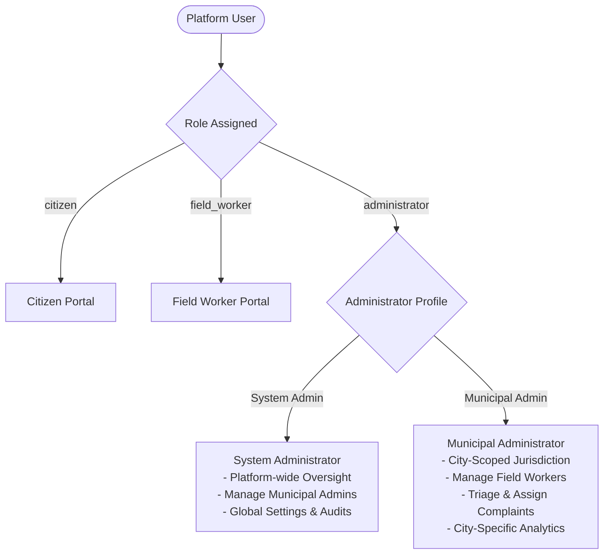

# Civic Services Platform

[](LICENSE)
[](https://www.python.org/)
[](https://flask.palletsprojects.com/)
[](https://vuejs.org/)
[](https://vitejs.dev/)
[](https://tailwindcss.com/)

An enterprise-grade civic issue reporting and municipal management platform. The application enables **citizens** to report road hazards (potholes) with geotagged map coordinates and photo verification, empowers **administrators** with hierarchical municipal oversight and intelligent dispatch, and provides **field workers** with real-time assignment tracking and repair evidence logging.

---

## 📌 Context & Portfolio Notice

This project originated as an academic Software Engineering capstone / Scrum team project under the university organization **IITMPivotLabs** (`MAY2026-Team-005`). 

This repository is maintained independently by **Mohd. Afsar ([@AfsarAI](https://github.com/AfsarAI))** as a personal portfolio showcase, reference implementation, and ongoing engineering sandbox.

- **Original Academic Organization:** [IITMPivotLabs](https://github.com/IITMPivotLabs)
- **Original Team Repository:** `IITMPivotLabs/MAY2026-Team-005`
- **Maintained By:** [Mohd. Afsar (@AfsarAI)](https://github.com/AfsarAI)
- **Licensing:** Licensed under the [MIT License](LICENSE). All historical contributions, commit authors, timestamps, and collaborative work are fully preserved in the Git history.

---

## 🎯 Individual Contributions & Engineering Scope

To maintain complete academic and professional transparency, below is an accurate breakdown of **Mohd. Afsar's** specific engineering contributions and responsibilities within the project:

### Primary Responsibilities & Jira Stories Handled by Mohd. Afsar (`23f2002023` / `@AfsarAI`):

| Jira ID | Module | Key Contributions |
|---|---|---|
| **TPS-66** | **Administrator Authentication & Security** | Implemented the administrator authentication subsystem, JWT credential validation, secure role-based session issuance, and sample environment configuration (`.env.example`). |
| **TPS-109** | **Multi-Tier Admin Hierarchy Schema** | Designed and migrated the database architecture supporting hierarchical administrator roles. Introduced the `cities` master table, `administrator_profiles`, and foreign key relations to isolate System Admin permissions from Municipal Admins. |
| **TPS-110** | **System Admin Municipal Management** | Engineered REST APIs and backend service logic allowing System Administrators to provision, inspect, modify, and deactivate Municipal Administrators scoped by municipal territory. |
| **TPS-111** | **Municipal Admin Field Worker Onboarding** | Implemented municipal administrative controls enabling city-level administrators to recruit, register, and manage field workers assigned to their specific city. |
| **TPS-77** | **Citizen Feedback & Repair Rating Subsystem** | Built citizen feedback APIs and service handlers allowing citizens to rate completed road repairs, submit qualitative feedback, and calculate satisfaction indices. |
| **TPS-80** | **Field Worker Complaint Assignment Engine** | Developed backend assignment workflows and validation logic for dispatching open complaints to designated field personnel based on municipal boundaries. |
| **TPS-81** | **Complaint Prioritization & Triage Logic** | Implemented administrative triage controls for evaluating complaint severity, setting urgency flags, and re-prioritizing open issues. |
| **TPS-93** | **Real-Time Assignment Notifications** | Designed the field worker notification pipeline delivering assignment payloads (complaint ID, GPS coordinates, priority level, administrative remarks, target completion window). |
| **Scrum & Reviews** | **Agile Collaboration & Code Quality** | Authored sprint pull requests, participated in daily scrum ceremonies, performed code reviews, resolved migration discrepancies, and maintained schema consistency across sprints. |

### Collaborative Team Modules:
Other critical platform modules were developed collaboratively across the Scrum team:
- **Frontend Architecture & UI Layout:** Client-side routing, base components, and state architecture.
- **Citizen Complaint Workflow:** Mobile-first report forms, photo uploads, Leaflet map integration, and citizen dashboard.
- **Reporting & Analytics:** PDF/CSV administrative exports, KPI aggregations, and performance metrics.
- **CI/CD & DevOps:** GitHub Actions pipeline configuration and deployment automation.
- **Scrum Documentation:** UML class diagrams, database ER diagrams, sprint plans, and meeting minutes.

---

## 🏗️ System Architecture & Key Features

### 1. Role-Based Access Control (RBAC) & Administrative Hierarchy

The platform implements a unified 3-role permission model with internal sub-profile scoping:



- **Citizens:** Submit complaints with mandatory photos, address, pincode, and GPS coordinates; track complaint life-cycle in real time; rate resolved repairs.
- **System Administrators:** Top-level authority with global visibility across all cities; onboard and manage Municipal Administrators; configure platform-wide duplicate detection radius.
- **Municipal Administrators:** Scoped strictly to their designated city; manage local field workers; triage, prioritize, and assign complaints; conduct local audits.
- **Field Workers:** View assigned repairs; inspect location and complaint details; update work status in real time; submit completion proof with before/after evidence.

### 2. Intelligent Complaint Processing
- **Duplicate Detection:** Automatic geographical clustering based on configurable radial distance thresholds, preventing redundant municipal dispatch.
- **Geographic Scoping & Pincode Mapping:** Seeded city and pincode registry ensuring accurate municipal jurisdiction mapping.
- **Photo Verification & Media Storage:** Validated image upload pipeline serving evidence URLs for citizen reports and field repair completion.
- **Timezone-Aware UTC Serialization:** Custom `UTCDateTime` database abstraction guaranteeing reliable ISO-8601 UTC timestamp serialization across all timezones.

---

## 🛠️ Technology Stack

### Frontend
- **Framework:** Vue 3 (Composition API)
- **Build Tool:** Vite 5
- **Routing:** Vue Router 4 (Role-guarded routes)
- **State Management:** Pinia
- **Styling:** Tailwind CSS 3.4
- **Maps & Geospatial:** Leaflet & Leaflet MarkerCluster
- **HTTP Client:** Axios (with Bearer token interceptors)

### Backend
- **Language / Runtime:** Python 3.13+
- **Framework:** Flask 3.x
- **API Engine & Documentation:** Flask-RESTX (Swagger / OpenAPI UI)
- **ORM & Data Layer:** Flask-SQLAlchemy 3.x & Marshmallow schemas
- **Database Migrations:** Flask-Migrate & Alembic
- **Authentication:** Flask-JWT-Extended (Access + Refresh token flow)
- **Security & CORS:** Flask-CORS, Werkzeug password hashing
- **Testing & Quality:** Pytest, Flake8

### Database & Storage
- **Development Database:** SQLite (`instance/civic.db`)
- **Production Database Target:** PostgreSQL compatible
- **File Uploads:** Local persistent volume storage with URL serving

---

## 📁 Repository Structure

```
.
├── backend/                         # Flask RESTful API application
│   ├── app/
│   │   ├── api/                     # Domain-driven API controllers & services
│   │   │   ├── administrator/       # Admin triage, user management, city scoping
│   │   │   ├── auth/                # JWT login, registration, token refresh
│   │   │   ├── citizen/             # Complaint submission, tracking, feedback
│   │   │   ├── fieldworker/         # Task acceptance, repair progress, completion
│   │   │   ├── locations/           # City & pincode lookups
│   │   │   ├── notifications/       # User & field worker notifications
│   │   │   └── reports/             # Analytics and export endpoints
│   │   ├── models/                  # SQLAlchemy ORM models
│   │   ├── schemas/                 # Marshmallow validation & serialization
│   │   ├── services/                # Business logic & domain services
│   │   └── utils/                   # Database helpers, geo-calculations, UTC types
│   ├── migrations/                  # Alembic database migration scripts
│   ├── tests/                       # Unit and integration test suites
│   ├── config.py                    # Environment configurations
│   ├── requirements.txt             # Python dependencies
│   └── app.py                       # Application entrypoint & CLI commands
├── frontend/                        # Vue 3 Single Page Application
│   ├── src/
│   │   ├── components/              # Reusable UI widgets, cards, inputs, map view
│   │   ├── pages/                   # Views organized by role (admin, citizen, worker)
│   │   ├── router/                  # Route configuration & navigation guards
│   │   ├── services/                # Axios API service clients
│   │   └── stores/                  # Pinia state stores (auth, complaints, alerts)
│   ├── package.json                 # Frontend dependencies and scripts
│   └── vite.config.js               # Vite build configuration
├── database/                        # Database schemas, ERD, and pincode dataset
│   ├── pincode.csv                  # City-pincode seed dataset
│   └── README.md
├── docs/                            # Comprehensive engineering documentation
│   ├── architecture/                # UML class diagrams & architecture notes
│   ├── database/                    # ER diagrams & schema specifications
│   ├── meetings/                    # Scrum ceremony logs (Daily Scrum, Planning)
│   ├── milestone3/                  # Sprint 1-2 deliverables & test reports
│   ├── milestone4/                  # Sprint 3 deliverables & test reports
│   └── milestone5/                  # Final sprint documentation & Swagger specs
├── .github/workflows/               # GitHub Actions CI/CD workflows
├── LICENSE                          # MIT Open Source License
└── README.md
```

---

## 🚀 Installation & Setup Guide

### Prerequisites
- **Node.js** >= 20.x (Recommended: 22.x LTS)
- **Python** >= 3.12 (Recommended: 3.13)
- **Git**

---

### Backend Setup

1. **Navigate to the backend directory:**
   ```bash
   cd backend
   ```

2. **Create and activate a virtual environment:**
   ```bash
   python3 -m venv .venv
   source .venv/bin/activate       # macOS / Linux
   # .venv\Scripts\activate        # Windows PowerShell
   ```

3. **Install dependencies:**
   ```bash
   pip install --upgrade pip
   pip install -r requirements.txt
   ```

4. **Configure environment variables:**
   ```bash
   cp .env.example .env
   ```
   *Edit `.env` to specify your `SECRET_KEY` and `JWT_SECRET_KEY` if desired. Default seed credentials are provided for development.*

5. **Initialize and migrate the database:**
   ```bash
   FLASK_APP=app.py flask db upgrade
   ```

6. **Seed default roles and System Administrator:**
   ```bash
   FLASK_APP=app.py flask seed
   ```

7. **Import city and pincode mapping dataset:**
   ```bash
   FLASK_APP=app.py flask import-pincodes
   ```

8. **Start the backend development server:**
   ```bash
   FLASK_APP=app.py FLASK_ENV=development flask run --host=0.0.0.0 --port=5000
   ```
   The backend API will run at `http://localhost:5000`.

---

### Frontend Setup

1. **Navigate to the frontend directory:**
   ```bash
   cd frontend
   ```

2. **Install Node dependencies:**
   ```bash
   npm install
   ```

3. **Configure environment variables:**
   ```bash
   cp .env.example .env
   ```
   *Ensure `VITE_API_BASE_URL` points to `http://localhost:5000/api/v1`.*

4. **Start the development server:**
   ```bash
   npm run dev
   ```
   The frontend will be accessible at `http://localhost:5173`.

---

## 📖 Interactive API Documentation (Swagger UI)

With the backend running, explore all REST endpoints interactively via the built-in Flask-RESTX Swagger interface:

🔗 **URL:** `http://localhost:5000/api/v1/docs`

### Authenticating in Swagger UI:
1. Call `POST /api/v1/auth/login` with your credentials:
   ```json
   {
     "email": "admin@civicservices.local",
     "password": "Admin@123456"
   }
   ```
2. Copy the returned `access_token`.
3. Click the **Authorize 🔒** button at the top-right of the Swagger UI.
4. Input: `Bearer <your_copied_token>` and click **Authorize**.
5. All protected endpoints can now be executed directly from the browser.

---

## 🧪 Testing & Code Quality

### Running Backend Tests
Execute the unit and integration test suite with `pytest`:

```bash
cd backend
source .venv/bin/activate
pytest -v
```

### Code Style & Linting
Verify code compliance using `flake8`:

```bash
cd backend
# Project standard (120-character line length limit)
python3 -m flake8 app/ --max-line-length=120
```

---

## 👥 Contributors & Acknowledgements

This platform was developed as part of a collaborative Scrum team. Acknowledgements to all team members:

| Contributor | University Identifier | GitHub Profile | Role |
|---|---|---|---|
| **MOHD AFSAR** | `23f2002023` | [@AfsarAI](https://github.com/AfsarAI) | Developer & Maintainer |
| **Gautham** | `21f3002294` | [@21f3002294](https://github.com/21f3002294) | Team Member |
| **Rahul Verma** | `21f1001325` | [@21f1001325](https://github.com/21f1001325) | Team Member |
| **Hafiza Noor** | `23f2004875` | [@23f2004875](https://github.com/23f2004875) | Team Member |
| **Jitendra Kumar** | `23f1000704` | [@23f1000704](https://github.com/23f1000704) | Team Member |

---

## 📄 License

This project is licensed under the [MIT License](LICENSE).  
Copyright &copy; 2026 MAY2026-Team-005 / Mohd. Afsar.
