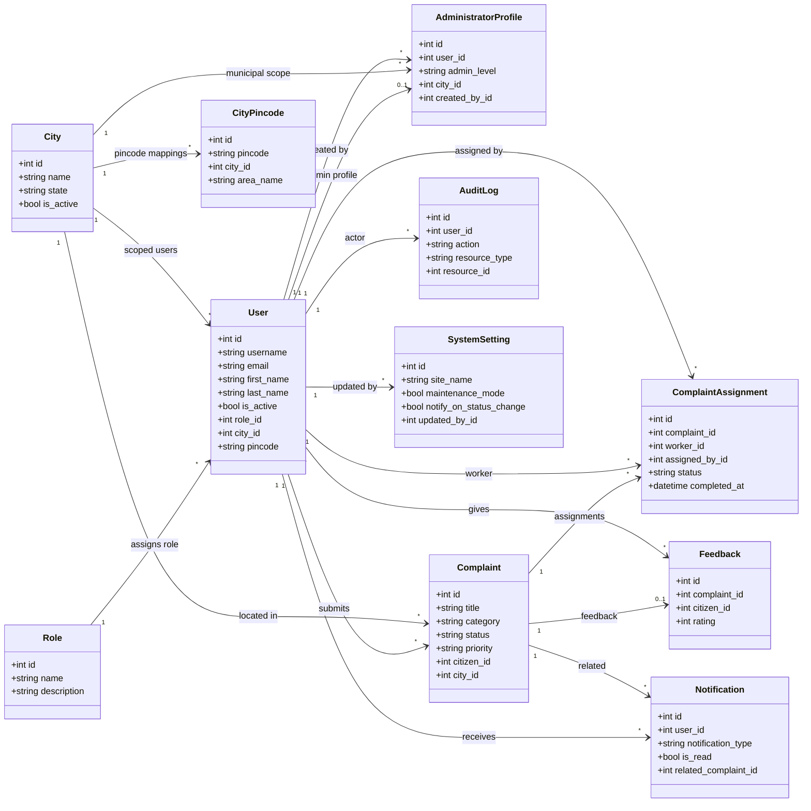

# Architecture Documentation

> Last reviewed: 2026-07-21

This folder contains architectural decision records (ADRs) and system design diagrams for the Civic Services Platform.

## Contents

| File | Description |
|---|---|
| `README.md` | Primary architecture overview and decisions |
| `diagrams/` | Source diagrams (`.drawio`) for architecture/database artifacts |

Planned additions:
- `adr/` directory for architecture decision records
- dedicated context/container sequence diagrams

## System Architecture Overview

```
┌─────────────────────────────────────────────────────────┐
│                     Client Browser                      │
│               Vue 3 SPA (Vite + Tailwind)               │
└───────────────────────┬─────────────────────────────────┘
                        │ HTTPS / REST
┌───────────────────────▼─────────────────────────────────┐
│                    Flask REST API                        │
│            Flask-RESTX  │  Flask-JWT-Extended            │
│            Blueprints   │  Flask-CORS                   │
└───────────────────────┬─────────────────────────────────┘
                        │ SQLAlchemy ORM
┌───────────────────────▼─────────────────────────────────┐
│                    SQLite Database                       │
│              (Alembic / Flask-Migrate)                  │
└─────────────────────────────────────────────────────────┘
```

## Technology Decisions

| Decision | Choice | Rationale |
|---|---|---|
| Frontend Framework | Vue 3 | Composition API, ecosystem maturity |
| Backend Framework | Flask | Lightweight, extensible, Pythonic |
| API Style | REST + Swagger | Industry standard, self-documenting |
| Authentication | JWT | Stateless, scalable |
| Database | SQLite | Simple dev setup, upgradeable |
| State Management | Pinia | Official Vue recommendation |

## Administrator Hierarchy Design

The project keeps exactly three coarse application roles:
- `citizen`
- `administrator`
- `field_worker`

Administrator subtype separation is implemented with composition, not a new role:
- `users` holds identity and coarse role
- `administrator_profiles` holds subtype and scope
- `cities` holds the municipal boundary

Why this design was chosen:
- keeps the existing login flow unchanged
- avoids introducing a new `SystemAdmin` role
- keeps admin-only state out of the base `roles` table
- scales better than a single boolean such as `is_system_admin`

Subtype rules:
- `system` administrators have no city and can manage municipal admins globally
- `municipal` administrators must reference exactly one city
- system-only permissions are enforced in backend decorators and controllers

## Class UML Diagram

Core backend domain classes and their primary relationships:



## Architecture Backlog

- [ ] Add C4 Context diagram
- [ ] Add C4 Container diagram
- [ ] Add sequence diagrams for key flows
- [ ] Document deployment architecture
