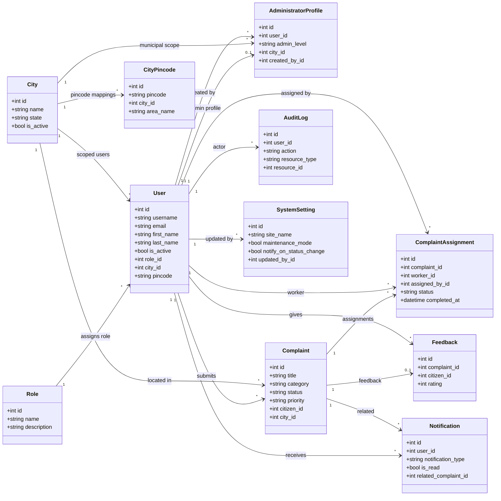

# Architecture Documentation

> Last reviewed: 2026-08-08

This folder contains architectural decision records (ADRs) and system design diagrams for the Civic Services Platform.

## Contents

| File | Description |
|---|---|
| `README.md` | Primary architecture overview and decisions |
| `diagrams/` | Source diagrams (`.drawio`) for architecture/database artifacts |

Planned additions:
- `adr/` directory for architecture decision records
- dedicated context/container sequence diagrams

## System Architecture Overview

```
┌─────────────────────────────────────────────────────────┐
│                     Client Browser                      │
│               Vue 3 SPA (Vite + Tailwind)               │
└───────────────────────┬─────────────────────────────────┘
                        │ HTTPS / REST
┌───────────────────────▼─────────────────────────────────┐
│                    Flask REST API                        │
│            Flask-RESTX  │  Flask-JWT-Extended            │
│            Blueprints   │  Flask-CORS                   │
└───────────────────────┬─────────────────────────────────┘
                        │ SQLAlchemy ORM
┌───────────────────────▼─────────────────────────────────┐
│                    SQLite Database                       │
│              (Alembic / Flask-Migrate)                  │
└─────────────────────────────────────────────────────────┘
```

## Technology Decisions

| Decision | Choice | Rationale |
|---|---|---|
| Frontend Framework | Vue 3 | Composition API, ecosystem maturity |
| Backend Framework | Flask | Lightweight, extensible, Pythonic |
| API Style | REST + Swagger | Industry standard, self-documenting |
| Authentication | JWT | Stateless, scalable |
| Database | SQLite | Simple dev setup, upgradeable |
| State Management | Pinia | Official Vue recommendation |

## Timezone Handling

All `DateTime` columns use a custom `UTCDateTime` SQLAlchemy `TypeDecorator`
(`backend/app/utils/db_types.py`, `impl = DateTime` — no migration needed)
rather than plain `db.DateTime`. It normalizes to UTC on write and re-attaches
`tzinfo=timezone.utc` on read, guaranteeing every loaded datetime is
timezone-aware. This fixed a real bug where naive datetimes serialized via
`.isoformat()` omitted the UTC offset, causing the frontend's `new Date(...)`
to misparse them as local time (a 5:30h/IST display drift). **Any new model
column storing a timestamp must use `UTCDateTime`, not `db.DateTime`.**

## Administrator Hierarchy Design

The project keeps exactly three coarse application roles:
- `citizen`
- `administrator`
- `field_worker`

Administrator subtype separation is implemented with composition, not a new role:
- `users` holds identity and coarse role
- `administrator_profiles` holds subtype and scope
- `cities` holds the municipal boundary

Why this design was chosen:
- keeps the existing login flow unchanged
- avoids introducing a new `SystemAdmin` role
- keeps admin-only state out of the base `roles` table
- scales better than a single boolean such as `is_system_admin`

Subtype rules:
- `system` administrators have no city and can manage municipal admins globally
- `municipal` administrators must reference exactly one city
- system-only permissions are enforced in backend decorators and controllers

## Class UML Diagram

Core backend domain classes and their primary relationships:



## Architecture Backlog

- [ ] Add C4 Context diagram
- [ ] Add C4 Container diagram
- [ ] Add sequence diagrams for key flows
- [ ] Document deployment architecture

## Class Descriptions

These descriptions summarize the persistent ORM model attributes and the main responsibilities each class serves in the architecture. Most workflow logic such as registration, complaint assignment, notification delivery, and status transitions is implemented in the service layer rather than directly on the model classes.

### Role Class

**Description**

Represents the coarse-grained application role assigned to a user account. The system uses exactly three roles: citizen, administrator, and field_worker.

**Attributes**

| Attribute | Type |
|---|---|
| `id` | Integer |
| `name` | String |
| `description` | String |
| `created_at` | DateTime |
| `updated_at` | DateTime |

**Operations**

- Supports role lookup during authentication and authorization.
- Groups many `User` records under one role.
- Provides role constants used across the application.

### User Class

**Description**

Represents all registered users of the application, including Citizens, Administrators, and Field Workers.

**Attributes**

| Attribute | Type |
|---|---|
| `id` | Integer |
| `username` | String |
| `email` | String |
| `password_hash` | String |
| `first_name` | String |
| `last_name` | String |
| `phone` | String |
| `avatar_url` | String |
| `is_active` | Boolean |
| `role_id` | Integer |
| `city_id` | Integer |
| `pincode` | String |
| `created_at` | DateTime |
| `updated_at` | DateTime |

**Operations**

- `set_password()`
- `check_password()`
- `full_name`
- `is_administrator`
- `admin_level`
- `is_system_admin`
- `is_municipal_admin`

### AdministratorProfile Class

**Description**

Represents the subtype metadata for administrator users. It distinguishes system administrators from municipal administrators and stores municipal scope through `city_id`.

**Attributes**

| Attribute | Type |
|---|---|
| `id` | Integer |
| `user_id` | Integer |
| `admin_level` | String |
| `city_id` | Integer |
| `created_by_id` | Integer |
| `created_at` | DateTime |
| `updated_at` | DateTime |

**Operations**

- `is_system_admin`
- `is_municipal_admin`
- Enforces administrator scope through the `admin_level` and `city_id` combination.

### City Class

**Description**

Represents a city managed inside the platform. It acts as the shared reference entity for complaint routing, user location, municipal administrator scope, and pincode mapping.

**Attributes**

| Attribute | Type |
|---|---|
| `id` | Integer |
| `name` | String |
| `state` | String |
| `is_active` | Boolean |
| `created_at` | DateTime |
| `updated_at` | DateTime |

**Operations**

- Links users to their home or managed city.
- Links complaints to their routed city.
- Groups pincode mappings for location lookup.

### CityPincode Class

**Description**

Represents the mapping between a six-digit pincode and one or more city records. It supports onboarding, location search, and pincode-first complaint filing flows.

**Attributes**

| Attribute | Type |
|---|---|
| `id` | Integer |
| `pincode` | String |
| `city_id` | Integer |
| `area_name` | String |
| `district` | String |
| `state` | String |
| `is_active` | Boolean |
| `created_at` | DateTime |
| `updated_at` | DateTime |

**Operations**

- Resolves pincodes to one or more cities.
- Supports autocomplete and lookup flows in the locations API.
- Maintains the city-to-area mapping imported from CSV.

### Complaint Class

**Description**

Represents a civic complaint submitted by a citizen, such as a pothole or streetlight issue. It stores the complaint lifecycle, location snapshot, and reporting metadata.

**Attributes**

| Attribute | Type |
|---|---|
| `id` | Integer |
| `title` | String |
| `description` | Text |
| `category` | String |
| `status` | String |
| `priority` | String |
| `latitude` | Float |
| `longitude` | Float |
| `address` | String |
| `image_url` | String |
| `city_id` | Integer |
| `pincode` | String |
| `citizen_id` | Integer |
| `resolved_at` | DateTime |
| `created_at` | DateTime |
| `updated_at` | DateTime |

**Operations**

- Tracks complaint status from `pending` through `closed` or terminal states.
- Links a complaint to its citizen reporter and routed city.
- Connects to assignments and optional feedback.

### ComplaintAssignment Class

**Description**

Represents the assignment of a complaint to a field worker. It tracks who assigned the work, the worker handling it, and the repair lifecycle timestamps.

**Attributes**

| Attribute | Type |
|---|---|
| `id` | Integer |
| `complaint_id` | Integer |
| `worker_id` | Integer |
| `assigned_by_id` | Integer |
| `status` | String |
| `notes` | Text |
| `evidence_url` | String |
| `assigned_at` | DateTime |
| `accepted_at` | DateTime |
| `completed_at` | DateTime |
| `updated_at` | DateTime |

**Operations**

- Tracks assignment status from `assigned` to `completed` or `rejected`.
- Connects a complaint to the responsible field worker.
- Stores optional completion evidence for admin verification.

### Feedback Class

**Description**

Represents feedback submitted by a citizen after a complaint has been resolved or closed. Each complaint can receive at most one feedback record.

**Attributes**

| Attribute | Type |
|---|---|
| `id` | Integer |
| `complaint_id` | Integer |
| `citizen_id` | Integer |
| `rating` | Integer |
| `comment` | Text |
| `created_at` | DateTime |

**Operations**

- Stores the citizen's rating for a completed complaint.
- Stores the citizen's optional written comment.
- Enforces a one-feedback-per-complaint relationship.

### Notification Class

**Description**

Represents a system notification delivered to a user. Notifications are used for assignment events, status changes, and general announcements.

**Attributes**

| Attribute | Type |
|---|---|
| `id` | Integer |
| `user_id` | Integer |
| `title` | String |
| `message` | Text |
| `notification_type` | String |
| `is_read` | Boolean |
| `related_complaint_id` | Integer |
| `created_at` | DateTime |
| `read_at` | DateTime |

**Operations**

- Stores in-app notifications for users.
- Links a notification to a complaint when the event is complaint-specific.
- Supports unread tracking and mark-as-read workflows.

### AuditLog Class

**Description**

Represents an immutable audit entry for important system actions. It is used to record administrative and security-relevant events.

**Attributes**

| Attribute | Type |
|---|---|
| `id` | Integer |
| `user_id` | Integer |
| `action` | String |
| `resource_type` | String |
| `resource_id` | Integer |
| `details` | JSON |
| `ip_address` | String |
| `user_agent` | String |
| `created_at` | DateTime |

**Operations**

- Records who performed an action.
- Captures what resource was changed.
- Preserves metadata needed for traceability and review.

### SystemSetting Class

**Description**

Represents the singleton platform configuration row managed by the system administrator. It controls global settings such as maintenance mode and notification behavior.

**Attributes**

| Attribute | Type |
|---|---|
| `id` | Integer |
| `site_name` | String |
| `support_email` | String |
| `maintenance_mode` | Boolean |
| `notify_on_status_change` | Boolean |
| `default_complaint_priority` | String |
| `updated_at` | DateTime |
| `updated_by_id` | Integer |

**Operations**

- Stores global runtime configuration.
- Gates maintenance-mode access behavior.
- Controls whether automatic status notifications are sent.
