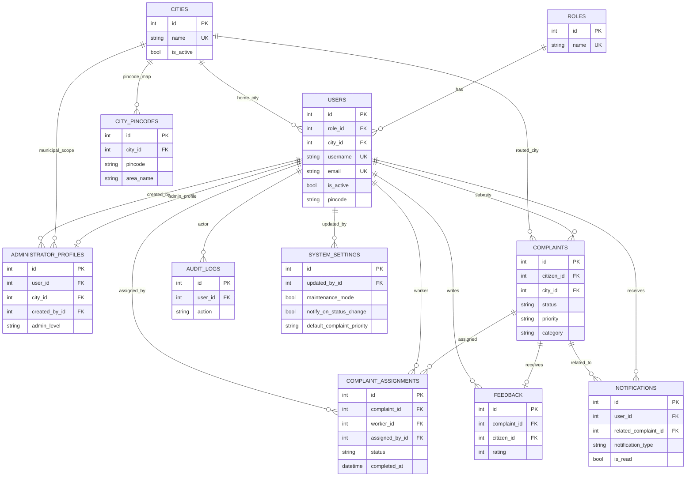

# Database Documentation

> Last reviewed: 2026-07-21

This folder contains the database schema, ERD, and migration history for the Civic Services Platform.

## Entity Relationship Diagram



### Location relationship summary

- `users.city_id → cities.id` stores the citizen's or worker's home city context.
- `complaints.city_id → cities.id` stores the routing snapshot used when the complaint was filed.
- `administrator_profiles.city_id → cities.id` scopes municipal administrators to a single city.
- `city_pincodes.city_id → cities.id` maps one pincode to one or more city records.

### Core relationship summary

- One `Role` can be assigned to many `User` records.
- One `User` with the citizen role can create many `Complaint` records.
- One `Complaint` can have many `ComplaintAssignment` records over time, but at most one active assignment in the business workflow at a time.
- One `User` with the field worker role can receive many `ComplaintAssignment` records and therefore work on many complaints over time.
- One `Complaint` can receive one `Feedback` record after it reaches a completed state (`resolved` or `closed`).
- One `User` can receive many `Notification` records.
- One `City` can be linked to many `User`, `Complaint`, `AdministratorProfile`, and `CityPincode` records.
- One administrator `User` can have zero or one `AdministratorProfile` record.
- One administrator `User` can create many `AdministratorProfile` records for municipal administrators.
- One `User` can create many `AuditLog` records.
- The current schema does not have a separate `ComplaintStatusHistory` table. Complaint status is stored directly in `complaints.status`.

## Complaint Status Flow

```
pending → assigned → in_progress → resolved → closed
                                 ↘ rejected  (admin can reject at any point)
    ↘ cancelled (citizen can cancel while still pending)
```


## Models

| Model | Table | Description |
|---|---|---|
| `Role` | `roles` | User roles (Citizen, Administrator, Field Worker) |
| `User` | `users` | Platform users with role association |
| `City` | `cities` | Canonical city master used by onboarding, routing, and admin scope |
| `AdministratorProfile` | `administrator_profiles` | Administrator subtype and municipal city scope |
| `Complaint` | `complaints` | Civic complaints submitted by citizens |
| `CityPincode` | `city_pincodes` | Master mapping of pincode to one/more cities |
| `ComplaintAssignment` | `complaint_assignments` | Assignment of complaints to field workers |
| `Notification` | `notifications` | System notifications to users |
| `Feedback` | `feedback` | Citizen feedback on resolved complaints |
| `AuditLog` | `audit_logs` | System audit trail |
| `SystemSetting` | `system_settings` | Singleton platform configuration managed by system administrators |

## Location Mapping Additions

- `users.city_id`, `users.pincode`: stores citizen/admin onboarding location.
- `complaints.city_id`, `complaints.pincode`: persisted routing snapshot at complaint creation time.
- `city_pincodes` indexes:
    - `ix_city_pincodes_pincode`
    - `ix_city_pincodes_city_id`

This makes runtime lookups DB-native and avoids querying CSV files in request paths.

// Civic Services Platform - Database Schema
// DBML (Database Markup Language)

```dbml
Table roles {
    id int [pk, increment]
    name varchar(50) [not null, unique]
    description varchar(255)
    created_at datetime
    updated_at datetime
}

Table cities {
    id int [pk, increment]
    name varchar(120) [not null, unique]
    state varchar(120)
    is_active boolean [not null, default: true]
    created_at datetime
    updated_at datetime
}

Table users {
    id int [pk, increment]
    username varchar(80) [not null, unique]
    email varchar(120) [not null, unique]
    password_hash varchar(255) [not null]
    first_name varchar(80) [not null]
    last_name varchar(80) [not null]
    phone varchar(20)
    avatar_url varchar(500)
    is_active boolean [not null, default: true]
    role_id int [not null, ref: > roles.id]
    city_id int [ref: > cities.id]
    pincode varchar(6)
    created_at datetime
    updated_at datetime
}

Table administrator_profiles {
    id int [pk, increment]
    user_id int [not null, unique, ref: > users.id]
    admin_level varchar(20) [not null, note: 'system | municipal']
    city_id int [ref: > cities.id]
    created_by_id int [ref: > users.id]
    created_at datetime
    updated_at datetime
}

Table city_pincodes {
    id int [pk, increment]
    pincode varchar(6) [not null]
    city_id int [not null, ref: > cities.id]
    area_name varchar(120)
    district varchar(120)
    state varchar(120)
    is_active boolean [not null, default: true]
    created_at datetime
    updated_at datetime

    indexes {
        (pincode, city_id, area_name) [unique, name: 'uq_city_pincode_city_area']
    }
}

Table complaints {
    id int [pk, increment]
    title varchar(200) [not null]
    description text [not null]
    category varchar(50) [not null]
    status varchar(30) [not null, note: 'pending | assigned | in_progress | resolved | closed | rejected | cancelled']
    priority varchar(20) [not null, default: 'medium']
    latitude float
    longitude float
    address varchar(500)
    image_url varchar(500)
    city_id int [ref: > cities.id]
    pincode varchar(6)
    citizen_id int [not null, ref: > users.id]
    resolved_at datetime
    created_at datetime
    updated_at datetime
}

Table complaint_assignments {
    id int [pk, increment]
    complaint_id int [not null, ref: > complaints.id]
    worker_id int [not null, ref: > users.id]
    assigned_by_id int [not null, ref: > users.id]
    status varchar(30) [not null, note: 'assigned | accepted | in_progress | completed | rejected']
    notes text
    evidence_url varchar(500)
    assigned_at datetime
    accepted_at datetime
    completed_at datetime
    updated_at datetime
}

Table feedback {
    id int [pk, increment]
    complaint_id int [not null, unique, ref: > complaints.id]
    citizen_id int [not null, ref: > users.id]
    rating int [not null, note: '1-5']
    comment text
    created_at datetime
}

Table notifications {
    id int [pk, increment]
    user_id int [not null, ref: > users.id]
    title varchar(200) [not null]
    message text [not null]
    notification_type varchar(50) [not null, default: 'general']
    is_read boolean [not null, default: false]
    related_complaint_id int [ref: > complaints.id]
    created_at datetime
    read_at datetime
}

Table audit_logs {
    id int [pk, increment]
    user_id int [ref: > users.id]
    action varchar(100) [not null]
    resource_type varchar(50)
    resource_id int
    details json
    ip_address varchar(45)
    user_agent varchar(255)
    created_at datetime
}

Table system_settings {
    id int [pk, increment]
    site_name varchar(120) [not null, default: 'Civic Services Platform']
    support_email varchar(120)
    maintenance_mode boolean [not null, default: false]
    notify_on_status_change boolean [not null, default: true]
    default_complaint_priority varchar(20) [not null, default: 'medium']
    updated_at datetime
    updated_by_id int [ref: > users.id]
}
```

## Migrations

Managed via **Alembic** through **Flask-Migrate**.

```bash
# Apply all pending migrations
flask db upgrade

# Roll back last migration
flask db downgrade

# Show migration history
flask db history
```

## Seeding Reference

The project uses two separate seed/import steps:

1. `flask seed` creates the three base roles and the default system administrator.
2. `flask import-pincodes` loads `city_pincodes` from `database/pincode.csv` and creates any missing `cities` rows.

Recommended setup order after configuring the backend:

```bash
cd backend
flask db upgrade
flask seed
flask import-pincodes
```

Use `flask import-pincodes --replace` if you need to rebuild the mapping table from the CSV.

## Documentation Backlog

- [ ] Add full ERD image (use draw.io or dbdiagram.io)
- [ ] Document all column constraints
- [ ] Add index documentation
