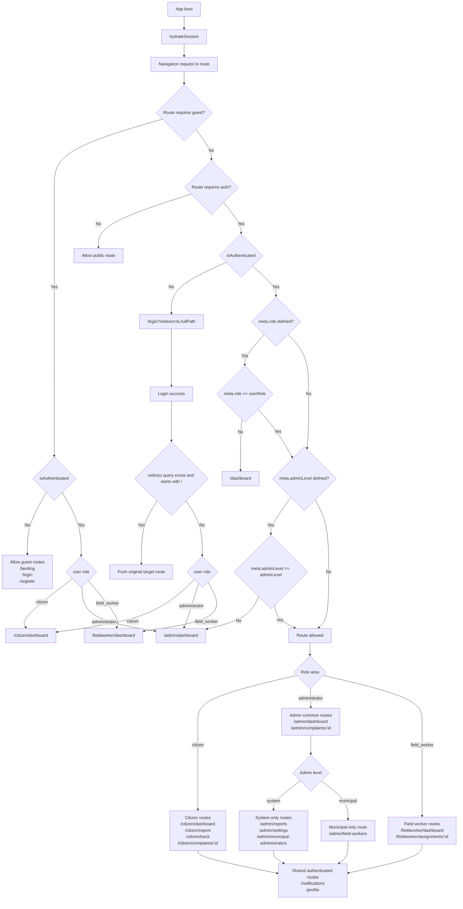

# UI / UX Documentation

> Last reviewed: 2026-07-21

This folder contains UI design documentation, wireframes, and component guidelines for the Civic Services Platform frontend.

## Pages

| Page | Route | Role |
|---|---|---|
| Login | `/login` | All |
| Register | `/register` | Citizen (pincode-first onboarding) |
| Dashboard | `/dashboard` | All (redirects by role) |
| Citizen Dashboard | `/citizen/dashboard` | Citizen |
| Report Complaint | `/citizen/report` | Citizen |
| Track Complaint | `/citizen/track` | Citizen |
| Complaint Details | `/citizen/complaints/:id` | Citizen |
| Administrator Dashboard | `/admin/dashboard` | Administrator |
| Admin Complaint Details | `/admin/complaints/:id` | Administrator |
| Reports | `/admin/reports` | Administrator |
| System Settings | `/admin/settings` | System Administrator |
| Municipal Administrators | `/admin/municipal-administrators` | System Administrator |
| Field Workers | `/admin/field-workers` | Municipal Administrator |
| Field Worker Dashboard | `/fieldworker/dashboard` | Field Worker |
| Field Worker Assignment Details | `/fieldworker/assignments/:id` | Field Worker |
| Notifications | `/notifications` | All authenticated roles |
| Profile | `/profile` | All |
| Not Found | `/:pathMatch(.*)` | All |

## UI Navigation Flow

The frontend route flow is enforced by `src/router/index.js` and `useAuthStore` session hydration.

### Guard behavior summary

- Unauthenticated users trying to open protected routes are redirected to `/login?redirect=<target>`.
- Authenticated users opening guest-only routes (`/landing`, `/login`, `/register`) are redirected to their role dashboard.
- Role-protected pages enforce role match:
	- mismatch redirects to `/dashboard`
	- admin-level mismatch redirects to `/admin/dashboard`

### Route flow diagram

### Primary user journeys

1. Citizen: `/login` -> `/citizen/dashboard` -> `/citizen/report` -> `/citizen/track` -> `/citizen/complaints/:id` -> `/notifications` or `/profile`.
2. System administrator: `/login` -> `/admin/dashboard` -> `/admin/complaints/:id` -> `/admin/reports` or `/admin/settings` or `/admin/municipal-administrators`.
3. Municipal administrator: `/login` -> `/admin/dashboard` -> `/admin/complaints/:id` -> `/admin/field-workers`.
4. Field worker: `/login` -> `/fieldworker/dashboard` -> `/fieldworker/assignments/:id` -> `/notifications` or `/profile`.

## Layout Components

| Component | Description |
|---|---|
| `DefaultLayout` | Main layout with Navbar, Sidebar, Footer |
| `AuthLayout` | Minimal layout for Login page |
| `Navbar` | Top navigation bar |
| `Sidebar` | Role-aware side navigation |
| `Footer` | Application footer |

## Design System

- **CSS Framework:** Tailwind CSS v3
- **Color Palette:** To be defined in `tailwind.config.js`
- **Typography:** To be defined
- **Icons:** To be decided (e.g. Heroicons / Lucide)

## UI Docs Backlog

- [ ] Add Figma/wireframe links
- [ ] Document component library
- [ ] Add responsive breakpoint guidelines
- [ ] Define color tokens

## Pincode-first Forms

- Citizen registration now requires pincode lookup before city selection.
- Municipal administrator creation uses the same flow: enter pincode, then select one resolved city.
- UI behavior by lookup result:
	- No match: show inline message and block submit.
	- Single match: auto-select city.
	- Multiple matches: require explicit city choice.

## Field Worker Task Flow

- `FieldWorkerDashboard.vue` shows stat cards (total/active/completed/rejected) sourced from `GET /fieldworker/dashboard`, plus a paginated, status-filterable assignment table sourced from `GET /fieldworker/assignments` (same card/table/badge styling as `CitizenDashboard.vue`).
- `AssignmentDetails.vue` (route `/fieldworker/assignments/:id`) shows the complaint photo, description, location (with an external map link), reporter contact info, a status timeline, and an actions panel that adapts to the current status:
	- `assigned` → Accept
	- `accepted` → Start repair work (notes optional) or Reject
	- `accepted`/`in_progress` → Mark as complete, with an optional photo-evidence upload (camera or gallery) reusing the citizen photo-upload UX
	- `in_progress` → Reject still available
	- `completed`/`rejected` → read-only, no actions shown

## Shared Profile Page (all roles)

- `Profile.vue` (route `/profile`) is one shared page for citizen, administrator, and field worker — no per-role profile screens.
- Two tabs: "Profile Details" and "Change Password".
- Profile Details: circular avatar (photo or initials fallback) with camera/gallery upload buttons; editable `first_name`/`last_name`/`phone`; `username` and `email` shown read-only (never editable); administrator level shown as an info chip when applicable.
- Change Password: current/new/confirm password fields with show/hide toggles, using the same password-strength rules as registration.
